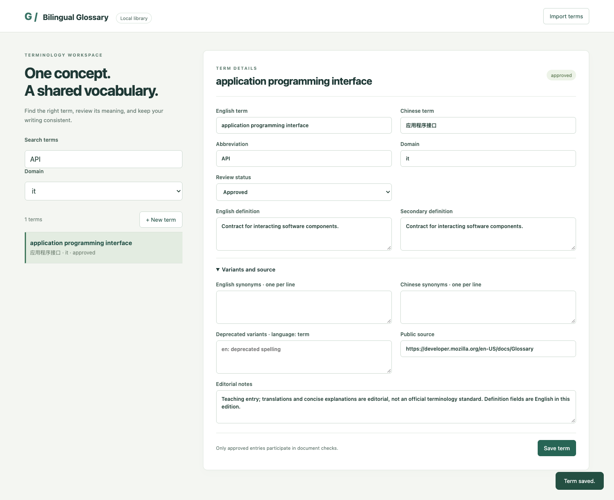

# Bilingual Glossary

A local Chinese–English terminology library with fuzzy lookup, pinyin initials, approved terminology checks, reviewable fixes, portable TBX snapshots, a browser editor and read-only MCP tools. Python 3.11+. MIT licensed. No online dictionary, translation API or cloud account.

All interfaces, documentation and example definitions are English. Chinese term strings remain bilingual data. The library includes **90 public textbook-level teaching entries: 30 each for water treatment, power chemistry and general IT**. Translations and brief definitions are editorial examples, not an official terminology standard.



## Quick start

```sh
python3 -m pip install -e .
gloss import examples/terms.json --json
gloss search fst --json
```

The first import inserts 90 entries; repeating it skips 90 unchanged entries. The pinyin initials `fst`, abbreviation `RO`, Chinese `反渗透`, and fuzzy spelling `revers osmosis` all find **reverse osmosis**. Run `gloss serve` and open `http://127.0.0.1:8872` to search, filter, edit, approve and bulk import terms. Every browser asset is local.

## Term model and review states

Each term contains `id`, `domain`, `zh`, `en`, `abbr`, `definition_zh`, `definition_en`, `notes`, `source`, `status`, `updated_at`, plus `synonyms_zh`, `synonyms_en`, and `forbidden`. Synonyms are arrays of strings. Forbidden variants are objects such as `{"lang":"en","text":"inverse osmosis"}`. String shorthand infers Chinese when CJK characters are present, otherwise English.

Domains are lowercase slugs. Canonical Chinese and English names are unique within a domain. Status is `draft` or `approved`; new imports without a status default to draft. **Document checks and prompt fragments use approved terms only.** Search returns either state. Approval records a local editorial decision, not external certification.

SQLite stores `terms`, `variants`, and an FTS5 index. Writes are transactional; Chinese characters and fuzzy comparisons supplement token search. Search combines exact/substring matching, pinyin initials, FTS and RapidFuzz scores. Scores express textual similarity, not semantic certainty. Lookup scans the library for fuzzy candidates and is intended for modest local collections.

## Check documents and aligned translations

```sh
gloss check examples/review.md --json
gloss check examples/clean.md --json
gloss check examples/pair.csv --pair zh,en --json
gloss prompt --domain water-treatment --text examples/clean.md
```

The review document deliberately contains **five inconsistent variants and three forbidden variants**; the checker reports exactly those eight findings with file, line, canonical term and suggestion. The clean document has no findings. A successful check operation returns `ok:true` even when `data.passed:false`; findings produce exit code 1.

Matching selects the longest non-overlapping term across the library, preventing a short Chinese term from also matching inside a longer term. Latin boundaries prevent partial-word matches. Case-only English differences are ignored. Multiple distinct allowed spellings of the same concept produce consistency findings; an abbreviation alongside its full form is allowed. Each forbidden occurrence is reported separately.

For an aligned pair, the source concept requires its **canonical target term or abbreviation**. A target synonym alone does not satisfy the prescribed translation. Supported alignments:

- Markdown/plain text: alternating source and target paragraphs, separated by blank lines; paragraph count must be even.
- CSV: two named columns, `zh` and `en`; use `--pair en,zh` for reverse direction.
- PO: nonobsolete singular `msgid` / `msgstr`; plural entries are explicitly rejected.
- XLIFF: simple 1.2 `trans-unit` or 2.x `segment` with source/target text. Inline text is concatenated. No advanced segmentation reconstruction.

This is a lexical review tool. It does not interpret meaning, negation, quotations or grammatical inflection. Plain-text checks include code and quoted text; review findings in context. When identical aliases belong to different concepts, the longest-span tie resolves deterministically by canonical status and stable ID. Choose a domain to reduce ambiguity. XLIFF line locations are approximate for repeated or inline-marked source text.

## Review fixes before writing

```sh
gloss fix examples/review.md --json
gloss check examples/review.md --fix --json
# For your own reviewed document:
gloss fix data/document.md --write --json
```

The first two commands return unified diffs without changing files. Only `--write` applies replacements, after a dated document ZIP backup. Repairs replace forbidden variants with canonical terms; inconsistent allowed synonyms require editorial judgment. Automatic repairs support `.md` and `.txt`, avoiding damage to CSV/XML/PO structure. Repeating a completed repair makes no further changes. Ordinary write failures roll back files already written; the operation is not crash-atomic across multiple documents.

## Import, export and compatibility

```sh
gloss export --format json --out data/terms.json --json
gloss export --format csv --out data/terms.csv --json
gloss export --format tbx --out data/terms.tbx --json
gloss export --format csv --kb --out data/glossary.csv --json
gloss import data/terms.tbx --json
gloss backup --json
```

JSON uses `{ "schema_version": 1, "terms": [...] }`; a bare array is also accepted. Full CSV has scalar fields and JSON-encoded variant arrays, with UTF-8 BOM by default (`--no-bom` omits it). The `--kb` CSV contains exactly `zh,en,abbr,definition_zh,definition_en`, directly compatible with bilingual-kb-starter. It deliberately omits IDs, status and variants; importing it defaults to the general domain and draft status.

TBX export uses the ISO 30042 second-edition namespace and a **small custom DCA dialect**, named `BilingualGlossary`. It writes concept/language/term sections and preferred/admitted/deprecated statuses, plus a JSON `admin` extension for lossless preservation of this application's metadata. JSON, full CSV and this TBX export round-trip all stored fields exactly. External basic TBX3 `conceptEntry/langSec/termSec` and older `termEntry/langSet/tig` files can be imported. Unsupported metadata is omitted. This is not a claim of complete TBX-Basic schema validation or universal CAT-tool compatibility; consumers may discard the custom extension. XML entities and external resources are disabled.

Imports validate all records before committing. An identical ID or canonical-domain match is skipped when unchanged. Different existing entries require `--replace --yes`, with an automatic database backup. Conflicts roll back the entire import. Deletes require `--yes` and also back up. Backups contain a consistent SQLite snapshot including variants and FTS. Restore to an empty data directory after inspection.

## CLI reference

| Command | Example |
| --- | --- |
| Add | `gloss add --record '{"zh":"示例","en":"example","status":"draft"}' --json` |
| Update | `gloss update ID --record '{"status":"approved"}' --json` |
| Delete | `gloss delete ID --yes --json` |
| List/show | `gloss list --domain it --status approved --json`; `gloss show ID --json` |
| Search | `gloss search API --lang en --limit 5 --json` |
| Import | `gloss import FILE --replace --yes --json` |
| Export | `gloss export --format csv --out FILE --json` |
| Check | `gloss check FILE... --lang en --domain it --json` |
| Aligned check | `gloss check FILE --pair zh,en --json` |
| Repair | `gloss fix FILE... --write --json` |
| Prompt fragment | `gloss prompt --text FILE --domain water-treatment --json` |
| Backup | `gloss backup --json` |
| Browser | `gloss serve --host 127.0.0.1 --port 8872` |
| MCP | `gloss mcp` |

Global options work before/after subcommands: `--data-dir`, `--config`, `--json`, `--quiet`, `--version`. Data precedence is CLI, `GLOSS_DATA_DIR`, `[gloss].data_dir` in an explicit TOML file, then `./data`. Paths resolve from the shell's working directory. Database: `glossary.db`; backups: `backups/`; default backup timezone: `Asia/Shanghai`. UTC update timestamps use ISO 8601. See `examples/config.toml`.

JSON stdout is one envelope: `{ "ok": true, "data": ..., "warnings": [] }`, or `{ "ok": false, "error": { "code": "...", "message": "..." } }`. Logs use stderr. Exit codes: 0 successful operation/clean check, 1 findings or operation failure, 2 invalid arguments/confirmation/conflict, 3 missing term/file/config. `serve` and `mcp` are long-running processes. The browser is for one trusted local user; files are not encrypted.

## MCP

The official FastMCP SDK exposes four read-only tools sharing the same checker:

| Tool | Arguments |
| --- | --- |
| `lookup_term` | `query`, optional `lang` |
| `check_text` | `text`, optional `lang`, `domain` |
| `check_pair` | `source`, `target`, optional `source_lang`, `target_lang` |
| `glossary_for_text` | `text`, optional `domain` |

```json
{"mcpServers":{"bilingual-glossary":{"command":"/workspace/apps/bilingual-glossary/.venv/bin/gloss","args":["--data-dir","/workspace/data/bilingual-glossary","mcp"]}}}
```

The generated JSON Schemas are in [docs/mcp-tools.json](docs/mcp-tools.json). No tool translates text or modifies files.

## Verification, references and roadmap

```sh
python3 -m pip install -e '.[dev]'
ruff check .
ruff format --check .
pytest -q --cov=bilingual_glossary
```

The suite checks pinyin/abbreviation/fuzzy lookup, all eight seeded findings without extras, longest Chinese matching, paired formats, lossless TBX/CSV/JSON, transactional rollback, backup restoration, diff-only repair, approval states, web origin guards, every MCP tool and real stdio. The browser search/edit/create/approve/import flow was exercised on desktop and mobile, with no external runtime requests or JavaScript errors.

Background references for the editorial sample set: [USGS Water Science Glossary](https://www.usgs.gov/water-science-school/science/water-science-glossary), [IAPWS instrumentation guidance](https://iapws.org/techguide/Instrumentation-2015.pdf), and [MDN Glossary](https://developer.mozilla.org/en-US/docs/Glossary). They provide domain context; the sample definitions and Chinese translations are not quotations or source-endorsed terminology.

Roadmap: richer alignment support, grammar-aware matching, explicit ambiguity reporting and optional external TBX schema validation. See [AGENTS.md](AGENTS.md), [CHANGELOG.md](CHANGELOG.md) and [LICENSE](LICENSE).
